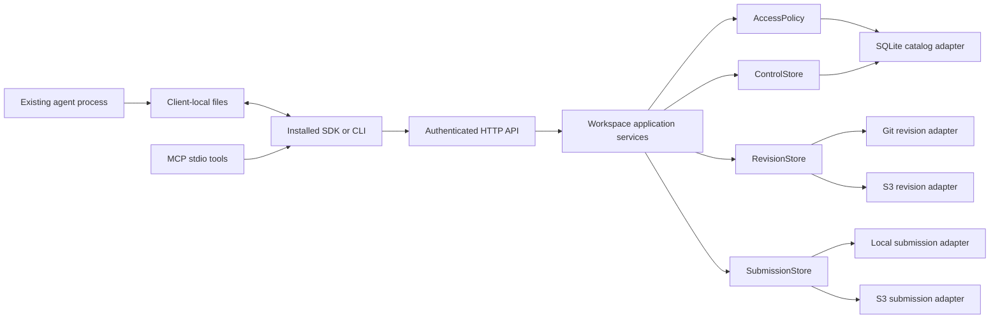

# Architecture

ContextVault coordinates authoritative workspace changes for independently executed agents.
The service accepts immutable snapshots through one publication protocol.
Clients materialize those snapshots beside the agents that use them.

## Responsibility boundaries

The agent host owns execution, writer coordination, and isolation.
The client owns local files, private journals, immutable captures, and explicit cleanup.
The service owns authorization, run state, accepted revisions, audit, and expiry.

AgentCore is not required by the implemented protocol.
A future filesystem adapter must preserve ContextVault's publication boundary.
A direct writable canonical bucket mount would bypass that boundary.

## Ports and adapters

| Port | Contract | Current adapter |
|---|---|---|
| `ControlStore` | Atomic authority, run, operation, receipt, publication, and collection coordination | `SqliteControlStore` |
| `AccessPolicy` | Evaluate current identity, grants, customer scope, and revocation epochs | `CatalogAccessPolicy` |
| `RevisionStore` | Prepare immutable content; read exact internal references; collect fenced orphans | `GitRevisionStore`, `S3RevisionStore` |
| `SubmissionStore` | Store immutable attempts; register receipts; seal exact selections | `LocalSubmissionStore`, `S3SubmissionStore` |
| `WorkspaceMaterializer` | Allocate, hydrate, capture, journal, and clean client-local files | Installed SDK materializers |

Contracts live in [src/ports](../src/ports/index.ts).
Domain types and transitions live in [src/domain](../src/domain/index.ts).
[Runtime composition](../src/config/runtime.ts) selects concrete storage adapters.
Application code receives ports instead of choosing storage from HTTP input.

## Authoritative state

The catalog stores each workspace's accepted revision, storage binding, binding generation, version, and status.
It also stores actors, credentials, grants, permission epochs, runs, submissions, operations, cleanup, audit, and delivery state.

A revision adapter can prepare durable bytes without publishing them.
An object, Git ref, directory, or candidate listing never proves acceptance.
Readers select accepted content through catalog-scoped references.
Public revision IDs remain opaque on both backends.

Changing `CV_STORAGE_BACKEND` changes the default profile for new bindings.
Existing workspaces keep their recorded binding.
The [migration service](quickstart/operations.md#move-an-existing-workspace-between-adapters) verifies copies before an atomic binding switch.

## Runs and submissions

A run pins an accepted base revision and records `agentLabel`, `task`, and `reason`.
The run also records its authenticated actor and credential context.
Read-only runs complete without a submission or content publication.

A read-write client captures a complete snapshot after its writers stop.
Each uploaded file attempt receives its own immutable identity.
A receipt becomes selectable only after durable upload completion.
Sealing atomically chooses exact registered receipts and the complete manifest.
Late attempts cannot replace sealed contents.

Manifest validation preserves regular-file bytes and explicit directories.
Omitted paths represent deletion.
The client and service independently validate hashes, lengths, limits, and portable names.

## Publication

1. Persist the command identity and exact sealed source.
2. Claim a fenced processing operation.
3. Prepare and verify immutable candidate content.
4. Recheck current authority, versions, binding, and accepted base inside the catalog transaction.
5. Accept the revision and terminal run outcome atomically.
6. Record durable audit and outbox work in that transaction.

A conflicting accepted head produces a recorded conflict outcome.
ContextVault does not automatically merge competing snapshots.
A successful no-change or read-only finalization can leave current content unchanged.

Abort applies to a known active run and publishes no submitted edits.
A finalizing run requires operation reconciliation rather than a competing abort.
Cleanup has its own state machine and cannot undo accepted publication.

## Versions and recovery

| Identity or version | Purpose |
|---|---|
| Workspace version | Optimistic current-head and administration checks |
| Run version | Lifecycle transitions |
| Lease version | Heartbeat renewal |
| Submission version | Upload and seal state |
| Operation ID and version | Durable command outcome and processing progress |
| Processing fence | Prevent stale processors from accepting work |
| Binding generation | Prevent stale work from targeting a replaced store |

The default run lease and processing claim each last five minutes.
Applications normally renew an active run about once per minute.
Processing renewal is separate from client heartbeat.
An expired run lease cannot be revived by a stale heartbeat.
An expired processing claim permits fenced recovery of finalization.

Clients persist commands before dispatch.
A restart supplies current credentials and resumes the retained private journal.
Reconciliation reuses the original request, idempotency key, and captured bytes.
Changing local files after uncertainty does not change that original submission.

## Maintenance and operations

Maintenance recovers registered operations, expires eligible active runs, delivers outbox events, and collects eligible unpublished content.
Collection requires current catalog permission, a collection fence, and proof that relevant writers stopped.
Expiry alone does not prove writer death.
Accepted history remains retained under the initial orphan-collection policy.

Migration drains all active runs, including read-only runs, and protects retained source pins.
It verifies history, immutable backups, target manifests, and target bytes before cutover.
An interrupted migration resumes through its recorded identity and renewed fence.

The catalog remains a durable local SQLite dependency even when content uses S3.
The current implementation does not establish a distributed catalog or automatic disaster recovery.
Operators own deployment topology, backups, key management, and restoration drills.

See [storage configuration](STORAGE_LAYER.md), [security](SECURITY_MODEL.md), and [operations](quickstart/operations.md).
